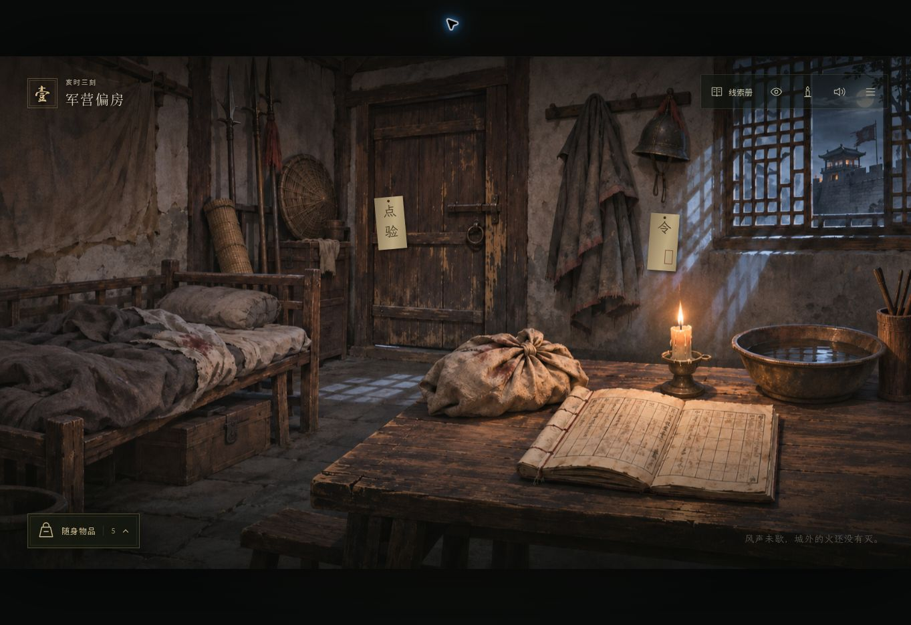
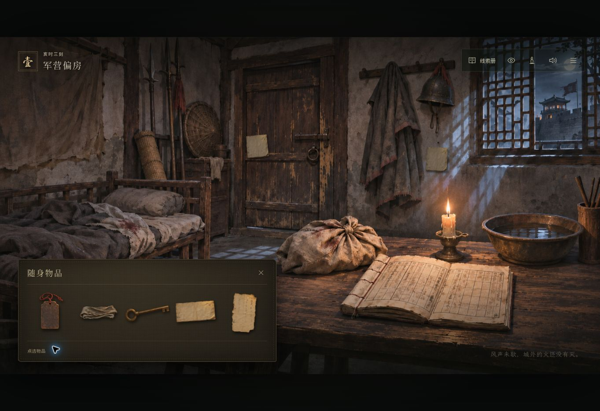
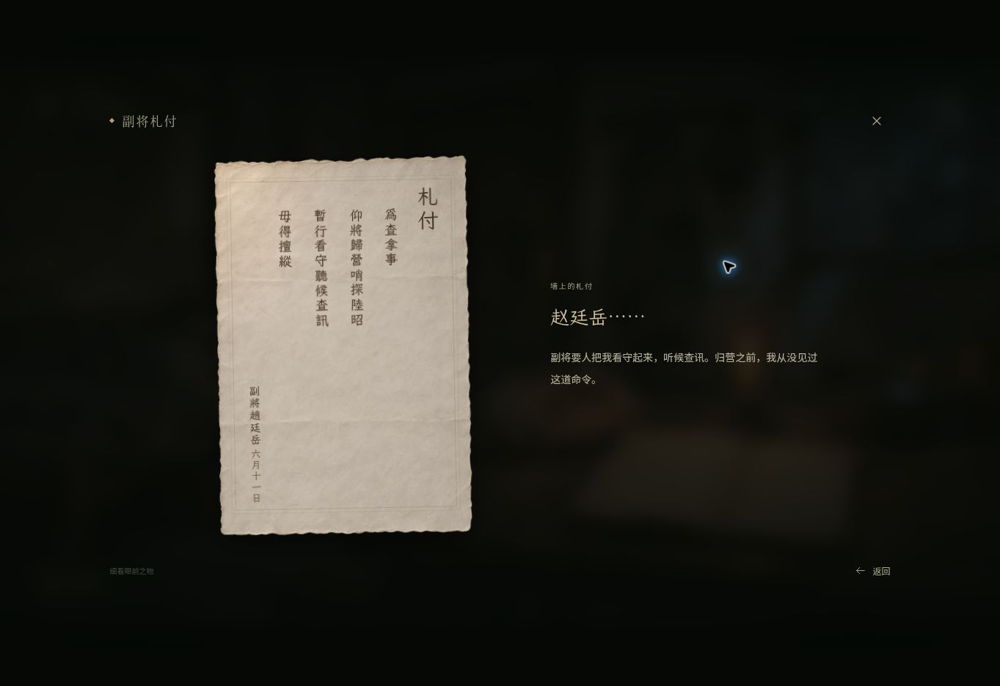
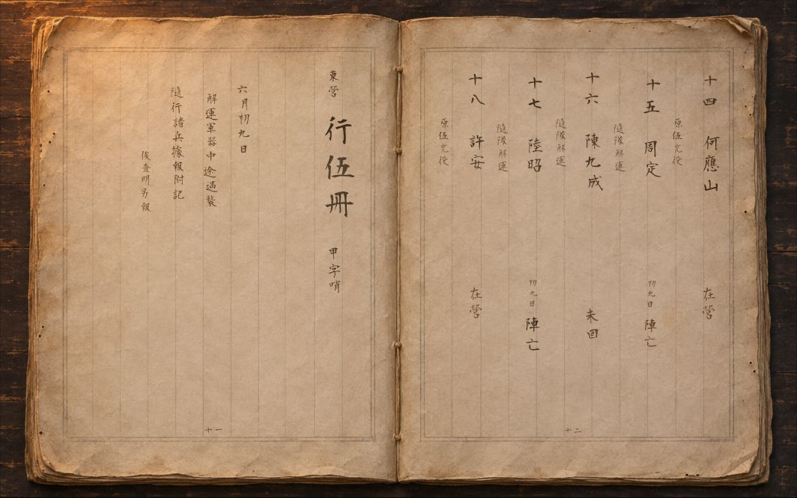
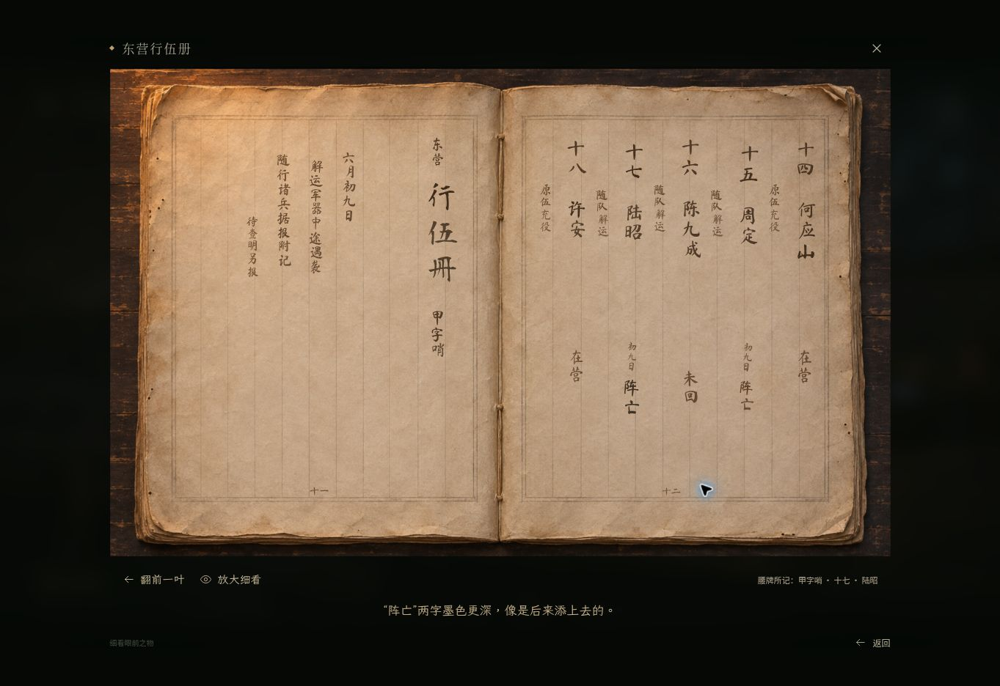
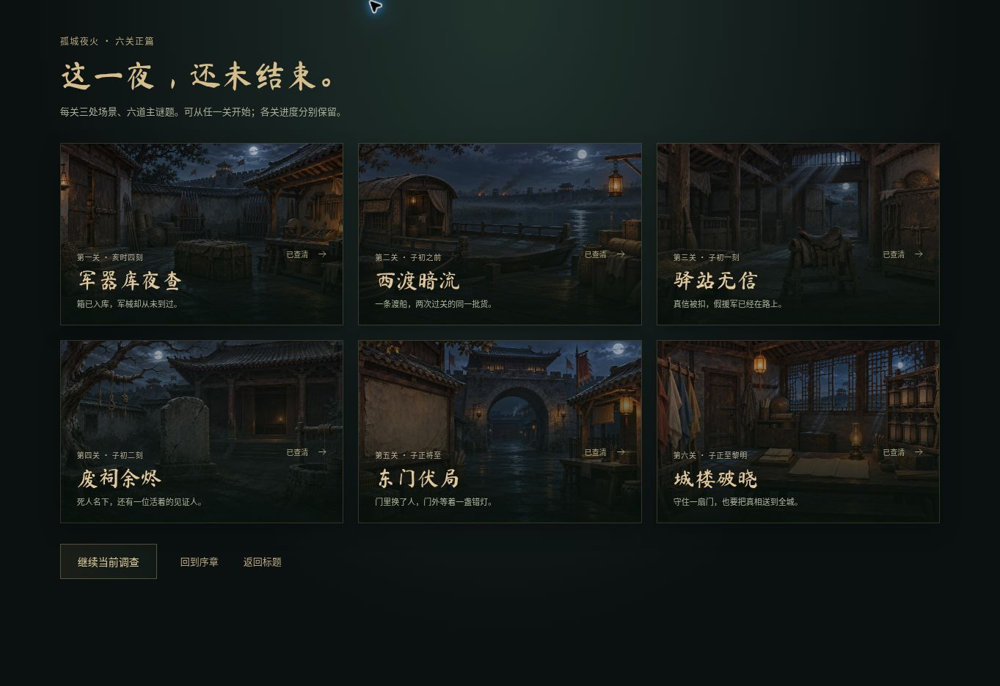
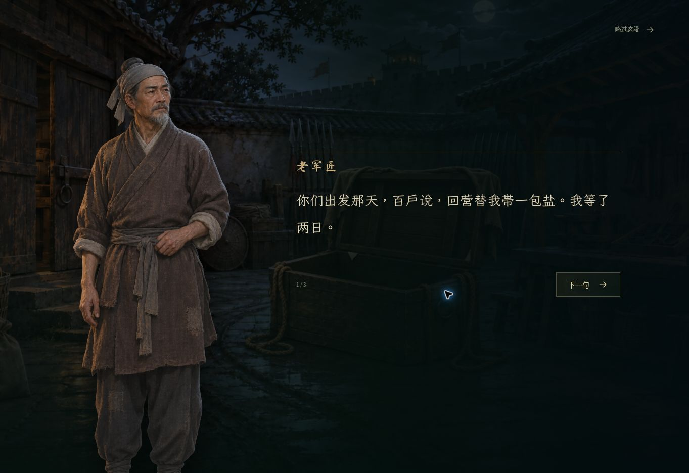
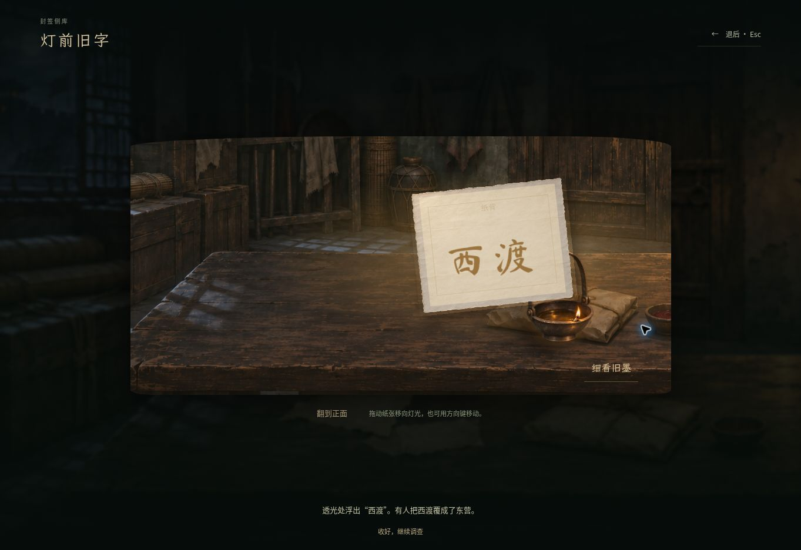

# 序章精修验收记录

日期：2026-11-10

## 自动检查

- 10 项 Node 状态测试通过：完整通关、提前解匣、道具前置、错序重试、木牌交换、中途存档、损坏存档、重复拾取、分次取物、剧情标记与旧存档兼容。
- TypeScript 类型检查与 Vite 生产构建由发布前构建执行。

## 桌面浏览器实机检查

在 1363 × 936 的浏览器视口完成两次偏房流程，并检查刷新续玩。

- 标题去除身份反转的提前剧透；开场可逐句阅读或跳过。
- 场景按原画比例铺开，背包收起；H 察看、B 背包、L 手记与 Esc 返回。
- 拾取腰牌及布条；蘸水动作完成后道具转换；刷新后湿布仍在。
- 鼠标实际拖动擦开泥污，达阈值显字；点按替代操作同样能完成。
- 军籍翻页、错误条目、正确条目核验；身份揭晓后触发巡兵搜查过场。
- 巡兵过场可阅读或跳过；刷新后不会再次触发已完成过场。
- 核验身份前读取陈九成记事，不提前引用军籍中的失踪记录。
- 两份点验线索和拘押令可阅读并在手记回看。
- 木牌点放、实际拖放、已有木牌交换；空槽与错序反馈后可以继续调整。
- 开匣过渡与原画定位一致；铜钥匙和两页文书分别拾取。
- 只取钥匙时不能遗下文书离开；全部收好后进入离开过场及试玩结尾。
- 三级提示逐层展开；手记回看；返回场景后对白关闭按钮不会残留拦截。
- 字体分工、腰牌字迹和木牌纹理经过截图检查。

移动设备触屏尚未单独实机验收。当前结束页明确说明军械库与废祠尚未开放。

浏览器测试使用本地试玩进度，与线上用户进度独立。线上发布是否成功，以发布服务返回的版本记录为准；线上仍保留原先的账户访问范围。

## 2026-11-11 物件与探索交互复验

- 状态测试 10/10 通过；新增改动的 TypeScript 检查通过，生产构建随本次发布打包执行。
- 桌面浏览器实际悬停墙上纸条：无名称、方框、光圈；DOM 中自动悬停名称和场景 `title` 均为零。键盘名称与聚焦反馈保留。
- 主动察看只显示位置点；按住 H 与松开、按钮短暂显示和打开近景时收回均检查。
- 背包里的腰牌、干湿布、钥匙与两份文书均加载实物原画；选中时才显示名称和查看入口，不再用线框图标表示实物。
- 水盆在未选布条时不自动建议蘸水；选布条后完成浸水，背包替换为湿布原画。
- 湿布与腰牌组合后，用真实鼠标拖动擦净配对泥污原画，达到阈值后显示字迹并收起。修复少量合并移动事件时松手不判定完成的问题。
- 本次走通军籍核验、巡兵过场、两份点验线索、四牌排列开匣、分别收钥匙与文书、查看残缺军令、离开偏房至试玩结束页。
- 五件道具背包截图检查通过，桌面背包无横向或纵向多余滚动（内容尺寸与可见尺寸相等）；画面没有常驻物品名。
- 素材裁切保留透明背景；六个新物件 PNG、干湿/脏净配对与中文字体字库覆盖已检查。
- 此轮未单独进行移动设备触屏实机验收；未增加军械库或废祠后续关卡。

## 2026-11-11 册簿与文书整体复验

- 核查当前偏房全部文书、剧情字句、武器名称、腰牌材料和场景册子；史料依据与原创边界见 [historical-review-v3.md](historical-review-v3.md)。
- 10 项状态测试通过；TypeScript 检查通过；生产构建由本次发布打包执行。
- 旧进度能继续；本地测试进度重启后重新完成开场、拾取、蘸水、真实鼠标擦拭木牌、行伍册翻叶、身份核验、巡兵过场、开匣取物和偏房结束页。
- 未清理腰牌时，点击陆昭条记只提示不能确认；清理后点击正确条记可发现阵亡添批。错误条记不改变身份进度。
- 册页中无横向表头、等高行、状态列、选中行高亮或自动圈选。正常悬停位置名称仍未恢复。
- 检查纸捻册页、竖写点验记、随行记、札付、解运底单、染血残札，以及它们在手记中的内容。长枪、火铳、弓弩、藤牌的字形与机关排列对应。
- 公文、底单、残札正文及手记内底单的文字边界检查通过；线索字号加大；纸面采用真实原画，去掉平面色块和几何锯齿撕口。
- 放大细看与收起放大通过；在浏览器缩放得到的 779×535 CSS 视口检查控制可见和放大阅读，之后恢复正常缩放。该检查不是移动设备触屏实测。
- 新木牌脏净状态保持物体比例，擦除中心区域后可完成；背包和近景共享物件原画。
- 新简繁字符在 UI 和手写子集中的缺字检查为空；字体、资产和许可文件均在项目中。
- 保留原存档键与四牌内部 ID，旧存档不需要重开。军器库、废祠仍未开放。

## 2026-11-11 册页笔墨复验

- 册页字形由规整文楷改为有提按笔锋的毛笔字形，加入小幅、固定的字势、大小和浓淡变化，并通过乘色与轻量纸纤维滤镜融入原画。
- 两页实体墨迹所需字符在新子集中均有覆盖且不是空轮廓；正文、姓名、牌号和阵亡附注没有改写。
- 在桌面浏览器检查两页字体、翻叶、放大与收起；姓名和附注边界均在纸面以内。
- 实际点击“陆昭”字迹的子节点，仍可触发该条记的核验反馈；按钮的完整朗读名称保留。
- 旧存档继续进入册页；没有调整存档格式、谜题条件和其他道具。TypeScript 检查通过，生产构建随发布打包执行。
- 本轮检查针对桌面册页文字表现，未另做移动设备实机检查。

## 2026-11-11 简体阅读复验

- 在旧的桌面试玩进度中核对甲乙两叶：陆昭、陈九成、阵亡、在营、随队解运等均为简体字形。两页翻叶与放大／收起操作正常。
- 册页正文使用 Gucheng Readable Ink，保留毛笔笔势、浓淡与纸纤维效果；装饰题签仍为“行伍冊”，辅助阅读名称为简体。
- 实际点击陆昭的单字节点，仍触发“牌号、姓名，分毫不差。”反馈。
- 点验记、随行记和札付的简体正文及排版在浏览器检查；姓名、主要文字未超出纸面。
- 关键人名、附注及全部点验／残札关键字在新毛笔和文楷字库中的缺字检查为空。
- 本轮为文字和字体修改，未改变谜题状态或存档结构；未另做移动设备实机验收。TypeScript 与生产构建随发布打包执行。

## 2026-11-11 六关正篇验收

- 新增六关另于序章，每关三处探索场景、六道主谜题，合计十八处场景、三十六题。
- 在桌面浏览器实际操作全部十八件物品的拾取和使用，回看三十六份文书，逐个解开三十六道主谜题；每题均观察到对应调查结果。关尾连续衔接下一关，最后抵达“生还”名册结尾。
- 测试过程中发现废祠配重存在两个正确组合，已调整干扰份量，三道配重题现在均有唯一的两项组合。
- 22 项状态、答案、依赖、道具使用、损坏存档和序章兼容测试通过。
- 页面刷新后从“继续正篇”恢复到原关卡的原场景，已解题与物品仍在。
- 文书正文与姓名使用简体毛笔字，固定小幅笔势与浓淡；新增三份本地字库的正篇所需 CJK 字符覆盖通过。放大时页面不增加横向溢出。
- 通过浏览器缩放检查 545×374 CSS 视口：文书区域可滚动，返回按钮固定可见，篇章列表切为单列并可滚动。这不是移动设备触屏实测。
- 背包与场景道具复用同一原画图集；场景没有自动悬停标签，H 只显示位置点。
- 生产构建由发布打包执行；实际难度与时长尚未做未知解玩家盲测。

## 2026-11-11 第一关精修 v7

- 27 项状态测试通过，新增木闩轴向／碰撞／边界、所有可达摆放可退回、残印四项必要条件、旧摆放兼容、单关备份恢复等检查；类型检查通过，生产构建随发布执行。
- 桌面浏览器从第一关备份重玩，实际拾取与使用工具，阅读六份线索，走通全部六题。木闩移动中刷新，再继续仍保留摆放和已用工具，最终能开箱。
- 检查侧库开箱后放行、前院空箱原画、透光后侧库纸框的旧去向，以及残印乙转正叠合后两处损伤确认。
- 军匠开箱提醒、三句巡兵灯影、透光回应、可选个人话题与验印话题、关尾告别均可阅读并返回；第一关正常衔接第二关。拟音使用本地 Web Audio，不包含人物配音。
- 恢复重玩前第一关后，六项完成标记与物品回归；篇章列表中其余五关的已完成进度保留。
- 检查 909×624、545×374 CSS 视口的人物界面和对白。修正窄屏横向视口中下一句按钮越出底部的问题，正文可滚动，按钮可见。恢复正常缩放。此项不是移动触屏实机测试。
- 未重复盲测其他五关，仍沿用上轮通关结果；本轮不是未知解玩家测试，尚不能据此确认实际难度、时长或商业发行完成度。

## 2026-11-11 第一关场景交互重做 v10

- 移除四张独立机关说明纸条，保留底单与账簿；末尾文字配对改为实物车辙调查。完整交互和存档边界见 [当前设计](first-chapter-world-v10.md)。
- 31 项测试通过；实际鼠标操作走通撬棍→砝码→木闩→掀箱衬取纸→拼签→放灯翻纸拖纸→验印，以及抽屉取灯、照地察痕、对账后主动遮灯等分支，最后正常进入第二关。
- 木闩中途刷新、透光翻面和拖动后刷新、巡兵事件中刷新均能继续；第二关原有 6/6 与三件物品仍在，篇章列表显示其余五关进度保留。
- 新纸张旧字以连续清晰度显示，可读位置有容差；真实鼠标拖动通过。提灯光斑随鼠标拖动，照近两处痕迹才能记录，错误观察保留进度。
- 检查桌面 1363×936 视口，无页面横向溢出，近景操作与返回、提示、背包可见。浏览器缩放快捷键未改变此环境的有效视口，因此本轮不声称完成窄视口实机验收；未做移动触屏测试或未知解盲测。
- 油灯、簿房遮灯后状态、侧库纸片移走后状态和车辙均使用同画风实物素材；新增字形已提供本地 OFL 后备子集。

## 2026-11-11 抽屉形体与开合修复 v11

移除透视拉伸的矩形贴图，使用有盒体、侧板、内腔、暗槽的同视角场景；匹配亮灯与遮灯两种状态。实机检查开关、取物、反复开合、刷新，以及遮灯前后状态组合。修复底栏透明区域截住点击、油灯图片超出容器的问题。31 项原有状态测试通过，生产构建随发布执行。详见 [素材及实机记录](art-drawer-v11.md)。

## 第18版：第一关发现顺序与原件重读

- 核查纸嫁衣、The Room、Outer Wilds、Obra Dinn、The Case of the Golden Idol 开发者资料，依据与思考路径见 chapter-one-design-v18.md。
- 桌面浏览器从“重访军器库”备份重玩，实际完成开场、随身原件查看、日期比对、巡兵遮灯、开箱、取残签、拼签、透光、携拘令比印、照车辙和离场对白。日期先于开箱完成，验证非固定顺序。
- 日期错选不同批次会反馈比较对象不一致；正确圈选后不会自动完成，主动并看后保留两份原件与发现。该阶段刷新并继续，会回到原件；收好底单后才触发巡兵。
- 透光实际使用鼠标拖动；开箱、车辙另使用键盘兼容操作。拼签完成可点纸角继续，透光完成可点露出的旧印转入核看。
- 核印第三个热点“左下印文”实际可点、可取消；先圈错处再取消、圈正确两处，可以完成。比较对象由玩家选择已有拘令，不再自动出现参照。
- 修正随身拘令在通用道具样式下字色过浅；序章、随身原件与旧签采用同一枚本作虚构印模。
- 现有存档补足随身原件；重玩/恢复保留其他章节进度。新增检查覆盖原件恢复、日期反馈与未解调查页不泄底。
- 本轮没有真实手机触屏验收，也没有未知解玩家盲测。上述流程属于已知答案的功能与衔接检查，不据此声称难度、时长或“顿悟感”已经验收。

## 第19版：第二至六关对象、发现与人物

- 后五关30处调查全部改造，具体对象、依赖和叙事边界见chapters-two-six-design-v19.md；新场景与字库来源见art-later-chapters-v19.md。
- 76项测试通过，包含30条实际动作路径每步存取、错误先后不推进、工具可达与场景门禁、旧草稿重置与旧完成保留、独立章节备份恢复、真实笔迹保存、原始记录发现时机。原有序章与第一关测试保留。
- 桌面浏览器实际从第二关连续完成至第六关结局，共30处对象。绳尾先抽不动、护送前门未撑稳、先落侧栅挡住原班门军的分支有明确反馈且可恢复。
- 实际鼠标横划阵亡旧注，给同袍留生还见证，刷新并继续后笔迹路径与两人状态保留。连续位置也测试键盘操作。修复拖动槽遮挡护送按钮和键盘重新渲染失焦。
- 修复已自动用上的道具仍可重复点击、缺少已用状态提示，以及栈桥两个拾取区域重叠。补齐新实体简体墨迹、旁白与操作字形，未覆盖第一关与序章旧字库。
- 新增陈九成伤者场景、东门等候的两班门军、交接后的守备与同袍。获救后暗室恢复为空席，交接后才出现案前人物。
- 本轮未做未知解玩家盲测、真实手机触屏验收或配音；通关是已知解功能检查，不能据此认定商业完成度、时长和顿悟感。

- 实机另做第四关单章备份重玩：第四关变为0/6，其余五关仍为已查清；恢复后第四关重新为已查清。

## Android离线体验版0.19.1

- 增加原生Java Activity、AndroidX WebViewAssetLoader与独立Android构建目录。APK内容对应第19版关卡，原生适配的CSS与返回桥接只在本地Android来源和专用User-Agent下启用。
- compile/target SDK35、min SDK26，包名com.sapeurs.guchengyehuo，versionCode1901。正式包使用独立RSA签名，签名材料不进入Git；debug包另加.debug后缀。
- 原有76项状态测试通过；TypeScript与Vite构建、assembleRelease、lintRelease通过。lint保留游戏横屏和基础adaptive-icon扫描的两项非阻断提醒。
- apksigner验证通过，APK不带任何uses-permission，不含ABI绑定的.so。核对99个dist文件与包内assets逐字节一致，含场景、字体和关卡JS。没有依赖网站登录或在线素材。
- Android背景绘制使用Canvas2D，后台暂停音频，返回键对接既有调查界面，导航与刘海区域使用原生安全边距。新代码未进行真实手机触屏验收。
- 软件模拟器：Android15/API35，x86_64，WebView124.0.6367.219；无KVM硬件加速。已确认APK安装成功、Activity进入RESUMED。首次游戏渲染期间模拟器同时出现SystemUI/Phone/Bluetooth异常与WebView的SIGTRAP，进入了本作的运行组件中断恢复界面。最小本地HTML对照也未完成可视化运行验收，尚不能仅据此判定手机兼容性。没有把安装成功记作完整启动、触摸或通关验收。
- 原生签名包及私有更新签名备份独立留存；后续更新须使用相同包名与密钥。用户手机本机存档与网页来源分开，覆盖安装保留，卸载/清除数据会丢失。
- 最终Canvas2D版本复测：覆盖安装Success，am start返回Status:ok、LaunchState:COLD；可视化仍进入运行组件中断恢复页，系统首次全屏说明及SystemUI无响应覆盖层也仍出现。因此本轮只验收安装、签名与离线资源，不记为游戏运行通过。待正常Android手机或具硬件加速的设备补测。
